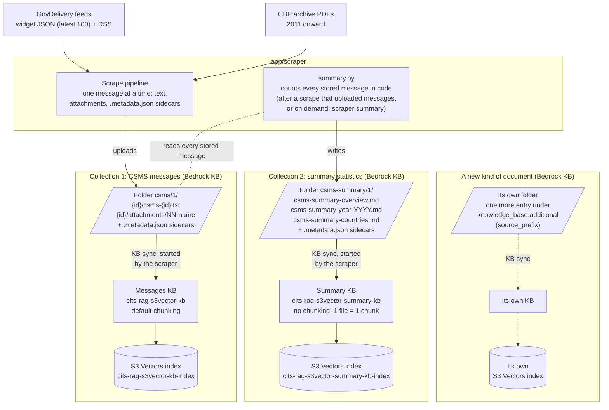
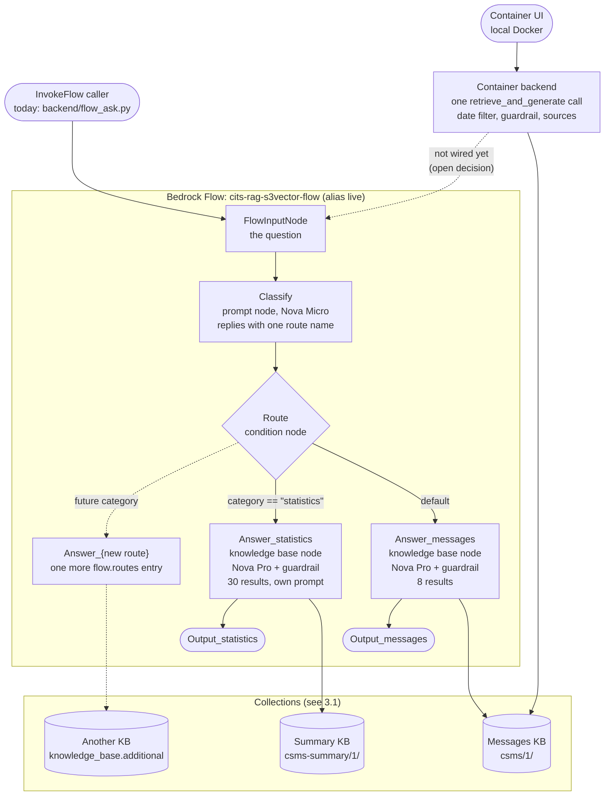

# New Architecture: CSMS questions on Bedrock Knowledge Base + Amazon Nova

Status: **partly built** (2026-11-16; first proposed 2026-11-03). This is the target design for the container UI (`app/ui/container/`). It extends the "Next steps: count questions" plan in `CLAUDE.md`, with two constraints added:

- **Bedrock Knowledge Base** is the only data store and the only ingestion pipeline.
- **Amazon Nova only** for model calls.

What is built so far is a simpler first version (user's decision, 2026-11-13), shown in §3: the scraper writes collection statistics into a second knowledge base, and a Bedrock Flow sends each question to the knowledge base for its category. It is deployed (2026-11-16) and the summary knowledge base is filled, but the container backend does not call the flow yet. §4–§11 are still the 2026-11-03 proposal and are not built. They remain the plan for what the first version cannot answer: counts by topic, counts over an arbitrary date range, and combinations such as a country within one month.

## 1. Goals

- Keep answering ordinary CSMS questions ("what changed in ACE for X?") with the current single `retrieve_and_generate` call.
- Add support for **count/list questions** ("how many CSMS messages are there?", "how many in 2025 / mentioning Brazil / with attachments?", "how many messages about X?" for **any** topic).
- Every number in an answer is computed by code. The model never writes one.

## 2. Why the KB alone can't count

- `Retrieve` / `RetrieveAndGenerate` return at most 100 **chunks** (default `KB_NUM_RESULTS` = 8). Chunks are not messages, and a topic often covers more than 100.
- Bedrock KB has no count or aggregate API. Implicit metadata filtering, query decomposition and reranking all improve retrieval, but none of them counts.
- S3 Vectors has no count API either.

So counting needs code that can see every message. The KB's own vector index already holds every message, so no second store is needed.

## 3. Overview: what is built (2026-11-16)

Two diagrams: how documents get into each collection, and how a question gets its answer. Both show the repo as it stands. The deployed stack matches it, except that it still has the older Lambda pipeline, which the repo no longer defines (see the last bullet of §3.1):

- Collection 1 holds 100 messages and 10 attachment files, all indexed (859 vectors).
- Collection 2 holds the 3 summary documents computed from those 100 messages, all indexed.
- The flow is deployed and answers when invoked with `backend/flow_ask.py`.

### 3.1 Ingestion: every document goes into a knowledge base

Each collection is a folder in the documents bucket (`cits-rag-s3vector-documents-<unique_id>`) that one Amazon Bedrock knowledge base reads, with its own index in the S3 Vectors bucket. The scraper is the only writer: it uploads the files and starts the knowledge base sync. There is no Lambda and no file uploaded by hand (user's decision, 2026-11-16).



| Collection | S3 folder and files | Indexed by | Vector index | Filled and refreshed by |
|---|---|---|---|---|
| 1. CSMS messages | `csms/1/`: `{id}/csms-{id}.txt` and `{id}/attachments/NN-name`, each with a `.metadata.json` sidecar | Messages KB `cits-rag-s3vector-kb` (default chunking, Titan Text v2) | `cits-rag-s3vector-kb-index` | A scrape. The scraper uploads the files, then runs the KB sync itself (`--no-sync` skips it; `--reindex` ingests each message directly instead). |
| 2. Summary | `csms-summary/1/`: `csms-summary-overview.md`, `csms-summary-year-YYYY.md` (one per year), `csms-summary-countries.md`, each with a sidecar | Summary KB `cits-rag-s3vector-summary-kb` (no chunking, Titan Text v2) | `cits-rag-s3vector-summary-kb-index` | `scraper summary`, or automatically after a scrape that uploaded messages. The scraper runs the KB sync itself. |

- **One knowledge base per collection, one vector bucket.** A knowledge base owns exactly one vector index, and a flow's knowledge base node cannot filter inside it. So each category the flow routes to has its own knowledge base and its own index, all in the same S3 Vectors bucket.
- **One command fills both collections.** A scrape that uploads messages syncs the Messages KB, rebuilds the summary and syncs the Summary KB (checked 2026-11-16 with `scraper message 69302472 --force`).
- **The summary is computed from the message files, not from an index.** `summary.py` reads every `csms-{id}.txt` and its sidecar under `csms/1/`, counts in code, and rewrites all the summary documents each time. Re-indexing collection 1 does not change it, and `scraper summary` rebuilds it at any time.
- **The summary needs three settings in the scraper's `.env.local`.** It is written only when `SUMMARY_PREFIX` is set, and the Summary KB is synced only when `SUMMARY_KNOWLEDGE_BASE_ID` and `SUMMARY_KB_DATA_SOURCE_ID` are set. The stack's `ScraperEnv` output has all three.
- **A file is indexed only if it is in a collection's folder.** Nothing else reads the documents bucket. A new kind of document gets its own folder and knowledge base (the dashed lane: a `knowledge_base.additional` entry), not a different pipeline.
- **Not deployed yet (2026-11-16).** The deployed stack still has the pipeline this replaces: an ingestion Lambda triggered by every upload (it skips both folders), a query Lambda with a public Function URL, the index `cits-rag-s3vector-index` and the static page's bucket. That index holds 4,196 vectors: 1,913 from six files uploaded by hand in June 2026 (three CSMS messages saved as text and three ACE CATAIR PDFs) and 2,283 from scraper uploads made before the Lambda skipped them. The next `cdk deploy` deletes all of it and changes nothing in the two knowledge bases.

### 3.2 Questions: classification → knowledge base



- **The route only picks the knowledge base.** `Classify` (Nova Micro, temperature 0) replies with one route name, and `Route` matches it. A reply it does not recognise goes to `flow.default_route` (`messages`). The question itself, unchanged, is the retrieval query of the `Answer_*` node that runs.
- **Each `Answer_*` node is one `RetrieveAndGenerate`** with Nova Pro and the stack guardrail. `Answer_statistics` asks for up to 30 results, enough to return every summary document (2 plus one per year of messages), and uses its own prompt (`iac/config/prompts/summary-answer.txt`).
- **Adding a category** (the dashed lane) is a `knowledge_base.additional` entry, when it has its own documents, plus a `flow.routes` entry in `iac/config/common.yml`. Bedrock allows 17 routes with this layout.
- **The container backend does not call the flow yet.** A flow's knowledge base node takes no metadata filter and returns no citations, so flow answers have no date range and no source links, which the backend's own call has. Whether to go through the flow, for every question or only those classified `statistics`, is an open decision. Today only `backend/flow_ask.py` invokes it.

## 4. Models (Amazon Nova only)

| Role | Model | Notes |
|---|---|---|
| Answer generation (`retrieve_and_generate`) | `us.amazon.nova-2-lite-v1:0` (fallback: `us.amazon.nova-pro-v1:0`) | Replaces `us.anthropic.claude-sonnet-4-6`. Set `knowledge_base.generation_model_id` in `common.yml` and the fallback in `backend/main.py` to the same value. |
| Planner | Nova Micro or Nova 2 Lite | Converse API, temperature 0, structured output via one forced tool (`toolChoice`). |
| Checker | Nova 2 Lite (escalate to Nova Pro / Premier if accuracy falls short) | Converse API, temperature 0. |
| KB embeddings | Titan Text v2 today, or **Nova 2 Multimodal Embeddings** (`amazon.nova-2-multimodal-embeddings-v1:0`) | Open decision: see §9. |

Check each model ID against `aws bedrock list-foundation-models` and the inference profiles in the deployment region, and enable access under Bedrock → Model access.

## 5. Request flow

### 5.1 Planner (every question)

One Nova call returns:

```json
{
  "intent": "answer | count | list",
  "topic": "string or null",
  "terms": ["keyword", "..."],
  "date_from": "YYYY-MM-DD or null",
  "date_to": "YYYY-MM-DD or null",
  "countries": ["..."],
  "has_attachments": true,
  "group_by": "none | month | year | country"
}
```

- `answer` goes to the unchanged `retrieve_and_generate` call.
- Dates in the question are **intersected** with the UI date range.

### 5.2 Ordinary questions (`intent = answer`)

Unchanged. A single `retrieve_and_generate` call with:
- the `date_numeric` metadata filter from the UI date range,
- the stack guardrail (ID + version) in `generationConfiguration`,
- sources from citations (GovDelivery bulletin URL, or the sidecar `attachment_url`); suppressed when `guardrailAction` is `INTERVENED`.

### 5.3 Count path (`intent = count | list`)

1. **Filter.** Apply the dates, countries and attachment flag to the catalog exactly. With no topic, that count is the answer and no more model calls are made.
2. **Rank.** Embed the topic with the **same model as the KB index** and rank **every** message left in scope by cosine similarity to the stored embeddings, plus keyword hits on `terms`. Ranking the whole scope is what gets past the 100-result cap.
3. **Check.** The Nova checker marks candidates `about` / `related` / `no`:
   - about 50 per call, up to 4 calls in parallel, working down the ranking;
   - stop when a batch has ≤ 1 match;
   - check every message when ≤ 300 are in scope;
   - cap at 1,500. Past the cap, report "at least N" (recommended; see §9).

   Verdicts are cached per `(catalog version, topic, message_id)`, so repeat questions give identical numbers.
4. **Answer from a template.**
   - Always state coverage, e.g. "**3** messages about ACE outages (15 more related: scheduled maintenance) in this assistant's collection of 100 messages, sent May 14 – Aug 2, 2026".
   - `group_by` produces a per-month / per-year / per-country breakdown.
   - Return the top 20 counted messages as sources ("showing 20 of N") in the existing `{answer, sources}` shape, so the frontend doesn't change.
   - Run `ApplyGuardrail` on the question and on the answer, since this path bypasses `retrieve_and_generate`'s guardrail.

## 6. Catalog: built from the KB's own index

- The backend pages through the KB's S3 Vectors index like `backend/kb_report.py` `scan_index`: `list_vectors` with `returnMetadata` and `returnData`.
- It groups chunks by `message_id` into one row per message: ID, dates, subject, countries, attachments, text (`AMAZON_BEDROCK_TEXT`) and embedding.
- It refreshes after each KB sync. The catalog version is the latest completed ingestion job ID.
- Counts therefore match exactly what the KB has indexed, which is also what ordinary answers can find.
- No changes to the scraper.

If the scan gets slow as the archive grows, save it as a snapshot after each sync. Keep the snapshot out of the collections' folders in the documents bucket, so that no knowledge base indexes it.

## 7. Changes required

| Area | Change |
|---|---|
| `iac/config/common.yml` | `knowledge_base.generation_model_id` → Nova; add planner/checker model IDs; embedding model if switching (§9). |
| `app/ui/container/backend/main.py` | Fallback model → Nova; add planner, count path, catalog loader, verdict cache. |
| IAM (container / Fargate task role) | `bedrock:InvokeModel` on the Nova models, `bedrock:ApplyGuardrail`, `s3vectors:ListVectors` / `GetVectors` on the KB index. |
| `.env.local.example`, `ContainerUiEnv` output | New model env vars; KB vector bucket + index name for the catalog scan. |
| `backend/kb_report.py` | Warn if the `AMAZON_BEDROCK_*` metadata keys change shape. |

## 8. Trade-offs accepted

- The container backend reads more than `retrieve_and_generate` (direct S3 Vectors reads on the KB index), and count questions make extra model calls.
- It relies on the KB's internal `AMAZON_BEDROCK_*` metadata keys.
- `related_countries` is cut short by the 1 KB sidecar limit, so country filters may miss some messages.
- Nova Lite/Micro are weaker than Claude at telling "about" from "related". The prototype measures this before the real build.
- Counts only cover what has been ingested.

## 9. Open decisions

1. **Embeddings:** keep Titan Text v2 (no change), or switch the KB to Nova 2 Multimodal Embeddings? Switching needs a **new KB + new S3 Vectors index + full re-sync**, because a KB's embedding model can't be changed after it's created.
2. **Checker model:** Nova 2 Lite first; Nova Pro / Premier only if the prototype shows it's needed.
3. **Broad topics past the cap:** "at least N" (recommended) or estimate from a sample.
4. **Backfill depth:** the Sept 2026 KB report had 100 messages (2026-05-14 – 2026-08-02); CBP has published 30k+ since 2011.

## 10. Ruled out (don't re-propose)

- Keyword counting (commit `a80e68c`): counts mentions, not topics.
- Fixed topic tags as the main mechanism: only covers topics listed in advance.
- A similarity cut-off without a check: scores aren't comparable across topics.
- A tool-using agent instead of the KB call: less predictable, and the model writes the numbers.
- Bedrock structured-data KB (Redshift text-to-SQL): `LIKE` matching only, plus Redshift Serverless, Glue and Lake Formation to run.
- A stats document in the KB: pre-computed totals only, and missing whenever retrieval doesn't surface it. Built anyway on 2026-11-13 at the user's direction, as collection 2 in §3: its own knowledge base, whose route retrieves every statistics document, which removes the "missing" problem. It is still pre-computed totals only.
- Managed KB: rejects `RetrieveAndGenerate`.

## 11. First step: prototype

Run against the messages already indexed, with about 20 hand-checked count questions: totals, per month, by country, and 10+ topics including ACE outages. Measure accuracy, latency and cost with Nova 2 Lite as the checker, then decide the open questions above. The target is 2–5 s and well under a cent per count question; confirm it against Nova pricing.

When it ships, move this into the Architecture section of `CLAUDE.md`, and update `.env.local.example`, `common.yml` and the `ContainerUiEnv` output.
