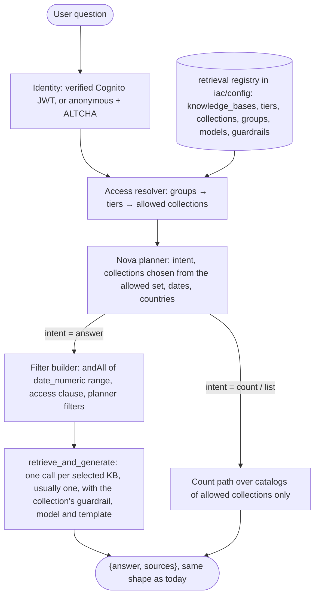

# Config-driven routing beats Bedrock Flows for CSMS

**No: Amazon Bedrock Flows is the wrong way to grow the CSMS assistant into multiple knowledge bases, categories and permission tiers; a thin, configuration-driven router inside the existing FastAPI backend is the right one.** The Flows knowledge-base node binds one fixed KB at deploy time and has no metadata-filter field, no citation output and no notion of the calling user, so the per-request `date_numeric` filter, the GovDelivery source links and every access rule would have to move into a Lambda node (the Lambda-based query path the project already rejected) inside a graph capped at 20 KB nodes and 10 versions, and the Nova 2 Lite model card lists Flows as "Not Supported". The other candidates fare no better: Bedrock Agents Classic, Amazon Q Business and Amazon Kendra closed to new customers at the end of July 2026, while AgentCore and the Managed Knowledge Base's `AgenticRetrieveStream` are model-driven retrieval loops that collide with the ruled-out tool-loop design, and managed KBs also refuse `RetrieveAndGenerate`. The recommended design keeps one `retrieve_and_generate` call per selected knowledge base (usually one per question) and moves everything that varies (knowledge bases, categories, permission tiers, groups, models, guardrails, prompt templates) into a `retrieval` registry in `iac/config` that CDK uses to build resources and the backend uses to route. Adding a category, a permission group, an isolated tier or a new vector store then becomes a YAML entry plus a deploy and a sync, while the code (registry loader, access resolver, filter builder, fan-out, per-collection count catalogs) is written once. Permissions follow AWS's layered guidance: dedicated KBs and buckets for hard boundaries, server-built filters from verified Cognito groups inside them, and count queries restricted to the user's collections before anything is counted. The largest risk is the model, not the orchestrator: model cards list "Knowledge base: Not Supported" for Nova Pro and Nova 2 Lite while the Nova User Guide documents Nova with `RetrieveAndGenerate`, so a short test against the existing KB, together with a test of whether `RetrieveAndGenerate` honours KB-level IAM, must come before any build.

## Flows cannot carry the date filter, the citations or the user

Flows deserves a fair hearing because it looks like the configuration-first answer. A flow is a JSON graph declared in CloudFormation as `AWS::Bedrock::Flow`, with `DefinitionSubstitutions` injecting KB IDs at deploy time ([AWS::Bedrock::Flow](https://docs.aws.amazon.com/AWSCloudFormation/latest/TemplateReference/aws-resource-bedrock-flow.html)). IAM authorizes `InvokeFlow` against a specific, taggable flow alias ([Bedrock service reference](https://servicereference.us-east-1.amazonaws.com/v1/bedrock/bedrock.json)). Flows runs in us-east-1 and both GovCloud (US) Regions ([Flows supported Regions](https://docs.aws.amazon.com/bedrock/latest/userguide/flows-supported.html)), and AWS's pricing example implies about **$0.035 per 1,000 node transitions**, roughly $0.0002 for a five-node question ([Bedrock pricing](https://aws.amazon.com/bedrock/pricing/)). The problem is that the CSMS assistant enforces three things on every request: the UI's date range, citation-derived source links and, once restricted categories exist, who is asking. The Flows knowledge-base node handles none of them.

The node's API shape is the decisive evidence. `KnowledgeBaseFlowNodeConfiguration` has a required `knowledgeBaseId` plus `modelId`, `guardrailConfiguration`, `inferenceConfiguration`, `numberOfResults` (1–100), `orchestrationConfiguration`, `promptTemplate` and `rerankingConfiguration`, and **no filter or retrieval-configuration field at all** ([KnowledgeBaseFlowNodeConfiguration API](https://docs.aws.amazon.com/bedrock/latest/APIReference/API_agent_KnowledgeBaseFlowNodeConfiguration.html)). Its only input is the query string. In generate mode it emits a plain string with no documented citations, and a guardrail can be attached only in generate mode ([Node types](https://docs.aws.amazon.com/bedrock/latest/userguide/flows-nodes.html); [Guardrails in flows](https://docs.aws.amazon.com/bedrock/latest/userguide/flows-guardrails.html)). KB nodes are not among the nodes that emit action traces, so citations cannot be recovered from the trace either ([FlowTraceNodeActionEvent](https://docs.aws.amazon.com/bedrock/latest/APIReference/API_agent-runtime_FlowTraceNodeActionEvent.html)). A third-party blog claims the node takes an optional metadata filter, but the API reference contradicts it ([factualminds blog](https://www.factualminds.com/blog/amazon-bedrock-flows-workflow-orchestration/)). The `date_numeric` range, which the container UI deliberately enforces in exactly one place, would have nowhere to go, statically or per request, and the `{label, url}` GovDelivery sources could not be rebuilt.

Routing is static by construction. The KB ID is configuration, never a runtime input, so serving N knowledge bases means one KB node per KB behind Condition nodes, under non-adjustable caps of **20 KB nodes, 5 Condition nodes of 5 conditions each, 40 nodes and 10 versions per flow** ([Bedrock quotas](https://docs.aws.amazon.com/general/latest/gr/bedrock.html)). Conditions support `==`, `!=`, numeric ordering and `and`/`or`/`not`, with no membership test, so a check like "is this category among the user's permitted ones" must first be computed by a Lambda or inline-code node. Inline code is still preview, runs Python 3.12 in a sandbox without internet access, and is limited to 5 nodes per flow and 25 running per account ([Node types](https://docs.aws.amazon.com/bedrock/latest/userguide/flows-nodes.html)).

Nothing in Flows knows who the user is. `InvokeFlow` takes the flow and alias identifiers, a trace flag, an execution ID, exactly one input and a latency setting, and no identity field. Every node then calls its KB, model or Lambda under the flow's single service role, and the Lambda event carries only the flow ARNs and the resolved inputs ([InvokeFlow API](https://docs.aws.amazon.com/bedrock/latest/APIReference/API_agent-runtime_InvokeFlow.html); [Flows service role](https://docs.aws.amazon.com/bedrock/latest/userguide/flows-permissions.html)). Group membership would be whatever the backend writes into the input document, and a misrouted branch could reach any KB the role can reach. The only AWS-enforced separation is one flow per permission tier, each with its own role, and the custom router gets the same per-tier roles without Flows.

Put the workarounds together and the working flow is Input → Lambda (call `retrieve_and_generate` with the filter, build sources) → Output. That is the code FastAPI already runs, moved into the Lambda-based query path CLAUDE.md excludes and wrapped in a hosted graph. The wrapper adds a network hop, returns output as whole per-node events with no documented token streaming, needs a replacement `FlowVersion` for every definition change against the 10-version cap, and has no CDK L2 construct, because `@aws-cdk/aws-bedrock-alpha` covers only Agents, Guardrails, Prompts, Inference Profiles and Knowledge Bases ([InvokeFlow API](https://docs.aws.amazon.com/bedrock/latest/APIReference/API_agent-runtime_InvokeFlow.html); [AWS::Bedrock::FlowVersion](https://docs.aws.amazon.com/AWSCloudFormation/latest/TemplateReference/aws-resource-bedrock-flowversion.html); [aws-bedrock-alpha README](https://docs.aws.amazon.com/cdk/api/v2/docs/aws-bedrock-alpha-readme.html)). Development also appears to have stalled. The Bedrock document history has **no Flows entries after September 26, 2025**, and inline code, multi-turn conversation and asynchronous executions are all still preview 16–21 months after they launched ([Doc history](https://docs.aws.amazon.com/bedrock/latest/userguide/doc-history.html); [Flow executions](https://docs.aws.amazon.com/bedrock/latest/userguide/flows-create-async.html)). Multi-turn also requires an Agent node backed by a Bedrock agent ([Multi-turn](https://docs.aws.amazon.com/bedrock/latest/userguide/flows-multi-turn-invocation.html)), which an account without recent Agents use can no longer create.

The Nova-only constraint settles it. New-architecture.md uses Nova 2 Lite for generation, and the Nova 2 Lite card lists **Knowledge base, Flows, Agents and Prompt management as "Not Supported"**; the Nova Pro card supports Flows, Agents and Prompt management but still lists Knowledge base as unsupported ([Nova 2 Lite model card](https://docs.aws.amazon.com/bedrock/latest/userguide/model-card-amazon-nova-2-lite.html); [Nova Pro model card](https://docs.aws.amazon.com/bedrock/latest/userguide/model-card-amazon-nova-pro.html)). Adopting Flows would therefore also force a model change. Flows suits workflows whose steps change often and that non-developers edit visually. Here the steps are stable (plan, then retrieve-and-generate or count), and what grows is a list of KBs, tiers and groups, which a registry handles more directly than graph edits. Revisit Flows only if the KB node gains per-request retrieval configuration and citation output and the chosen Nova model is listed as Flows-supported.

## Three alternatives closed to new customers on July 30, 2026

AWS narrowed the field this summer. On June 30, 2026 it announced that Bedrock Agents (renamed Agents Classic), Amazon Q Business and Amazon Kendra were entering maintenance, and all three closed to new customers on July 30; Q Business's own document history gives July 31 ([AWS service availability update](https://aws.amazon.com/about-aws/whats-new/2026/06/aws-service-availability/); [Q Business availability change](https://docs.aws.amazon.com/amazonq/latest/qbusiness-ug/qbusiness-availability-change.html)). The two AWS-native multi-KB products still open, AgentCore and the Managed Knowledge Base's `AgenticRetrieveStream`, both let a model decide what to retrieve, which brings back the "tool-using agent instead of the KB call" that new-architecture.md lists as ruled out. Standard KB features alone have no multi-KB call. The table compares all eight options on the properties this assistant must keep.

| Option | Open to a new account (Nov 2026) | Routing across KBs | Per-request `date_numeric` filter | Citations for `{label, url}` | Per-group permissions | Nova-only | Count questions | Verdict |
|---|---|---|---|---|---|---|---|---|
| Bedrock Flows | Yes, incl. GovCloud | Static: one KB node per KB behind conditions; ≤20 KB nodes, 5×5 conditions | No filter field on the KB node; needs a Lambda node | None from the KB node | Not identity-aware; one service role; one flow per tier | Nova 2 Lite card: Flows "Not Supported" | No help (100-result node, one sequential iterator) | **Reject for the request path** |
| Agents Classic + multi-agent collaboration | Only with Agents use in the prior 12 months; catalog frozen | Model picks KB by description; 2 KBs per agent by default | Yes, per KB in `sessionState` | Yes, same `Citation` type as R&G | One agent or alias per group (≤10 aliases) | Nova 2 Lite card: Agents "Not Supported" | Model writes the numbers | **Unavailable** |
| AgentCore harness + Gateway + Policy | Yes; harness GA Jun 2026, also GovCloud US-West | Model picks a tool; each standard KB needs a Lambda target | No per-invocation KB filter found | Depends on what the model passes through (unverified) | Strongest declarative option: JWT claims + Cedar, deny by default | Any model; Claude default must be overridden | Model writes the numbers | **Not now; borrow the authorization pattern** |
| Standard KB features alone | Yes (in use today) | None: one KB per call; ≤5 data sources per KB | Yes | Yes | Filters (logical), or one KB per tier (IAM; R&G scoping untested) | Model cards conflict; must test | Needs the planned count path | **Keep as the retrieval engine** |
| Managed KB + `AgenticRetrieveStream` | Yes; GA Jun 2026, no agentic retrieval in GovCloud | Yes: ≤5 managed KBs per call, routed by description | Yes, per retriever | Span citations by result index; no `location` | Email ACLs; S3 entries `USER` only; "not a security boundary" | CUSTOM model list undocumented | No index access, no facets | **Watch; breaks R&G and the count catalog** |
| Amazon Q Business | No (closed Jul 30–31, 2026) | One index per app, ≤50 data sources | Via API `attributeFilter` | Yes | Identity Center binding; anonymous mode forbids ACLs | No model choice | No | **Unavailable** |
| Kendra GenAI index (as a KB) | No (closed Jul 30, 2026) | One index | Attribute filter; Bedrock pass-through undocumented | Via the Bedrock KB | Attribute filters only | Generation via Bedrock | Facets count mentions (ruled out) | **Unavailable** |
| Thin config-driven router | Yes | Registry + Nova planner over allowed collections; code decides | Yes, unchanged | Yes, unchanged | Server-built filters + per-tier KB and role | Any model that passes the R&G test | Planned count path, per collection | **Adopt** |

Agents Classic would have been the most configuration-only fit. It associates KBs with natural-language descriptions, accepts a per-request metadata `filter` for each KB through `sessionState.knowledgeBaseConfigurations`, and returns citations in the same `Citation` type as `RetrieveAndGenerate` ([Control agent session context](https://docs.aws.amazon.com/bedrock/latest/userguide/agents-session-state.html); [Agents Classic maintenance mode](https://docs.aws.amazon.com/bedrock/latest/userguide/agents-classic-maintenance-mode.html)). But accounts without Agents activity in the preceding 12 months now get `AccessDeniedException` from `CreateAgent` and `InvokeInlineAgent`, "there is no exception process", the model catalog froze on July 30, 2026, and no features will be added (same source). Even an allowlisted account would start from a default of **2 KBs per agent** ([Bedrock quotas](https://docs.aws.amazon.com/general/latest/gr/bedrock.html)) and would leave the decision whether to query a KB at all to the model ([Augment an agent with a KB](https://docs.aws.amazon.com/bedrock/latest/userguide/agents-kb-add.html)). Multi-agent collaboration puts supervisor and collaborator passes in front of every answer, with no published latency figures, and AWS says routing-mode multi-agent on AgentCore is "not straightforward today" ([Agents Classic maintenance mode](https://docs.aws.amazon.com/bedrock/latest/userguide/agents-classic-maintenance-mode.html)).

AgentCore is the strategic successor, with a config-driven harness GA since June 2026 ("Trying a different model or adding a new tool is a config change, not a code rewrite") and harness, Gateway, Identity and Policy all available in GovCloud (US-West) ([AgentCore harness](https://docs.aws.amazon.com/bedrock-agentcore/latest/devguide/harness.html); [AgentCore Regions](https://docs.aws.amazon.com/bedrock-agentcore/latest/devguide/agentcore-regions.html)). It falls short here on specifics. The Gateway's built-in KB connector "is supported only for Amazon Bedrock Managed Knowledge Bases", so each standard S3 Vectors KB needs a hand-written Lambda target ([Managed KB connector target](https://docs.aws.amazon.com/bedrock-agentcore/latest/devguide/gateway-target-connector-managed-kb.html)), and the model, not code, chooses which KB tool to call. No per-invocation field was found that carries the UI date range to a KB tool, which leaves Gateway interceptors (code) or static, admin-pinned parameters ([Gateway fine-grained access control](https://docs.aws.amazon.com/bedrock-agentcore/latest/devguide/gateway-fine-grained-access-control.html)). The harness defaults to `global.anthropic.claude-sonnet-4-6` unless a Nova ID is set ([harness models](https://docs.aws.amazon.com/bedrock-agentcore/latest/devguide/harness-models.html)), and its always-present shell and file tools add about **900 input tokens per model request** unless restricted ([harness tools](https://docs.aws.amazon.com/bedrock-agentcore/latest/devguide/harness-tools.html)). Its best idea, inbound JWT validation with required claims plus Cedar policies that deny by default ([inbound JWT authorizer](https://docs.aws.amazon.com/bedrock-agentcore/latest/devguide/inbound-jwt-authorizer.html); [Policy authoring guide](https://docs.aws.amazon.com/bedrock-agentcore/latest/devguide/policy-authoring-guide.html)), can be reproduced in the router with Amazon Verified Permissions, as AWS's own multi-tenant RAG reference architecture does ([Verified Permissions blog](https://aws.amazon.com/blogs/architecture/secure-multi-tenant-rag-with-amazon-bedrock-and-verified-permissions/)).

Standard KB features are the right retrieval engine but not a router. `Retrieve` and `RetrieveAndGenerate` accept a single `knowledgeBaseId` ([Test retrieve and generate](https://docs.aws.amazon.com/bedrock/latest/userguide/kb-test-retrieve-generate.html)). A standard KB holds **at most 5 data sources, not adjustable**, and an account at most 100 KBs ([Bedrock quotas](https://docs.aws.amazon.com/general/latest/gr/bedrock.html)). Since September 30, 2026, new Confluence, SharePoint, Salesforce and Web Crawler connectors can no longer be created on customer-managed KBs ([Data source connectors](https://docs.aws.amazon.com/bedrock/latest/userguide/data-source-connectors.html)), and implicit, model-generated filtering is documented for Anthropic Claude models only, so the Nova planner must extract filters itself ([Configure and customize queries](https://docs.aws.amazon.com/bedrock/latest/userguide/kb-test-config.html)). Intelligent prompt routing, the other Bedrock feature with "routing" in its name, chooses between two models of one family such as Nova Lite and Nova Pro and never selects data ([Intelligent prompt routing](https://docs.aws.amazon.com/bedrock/latest/userguide/prompt-routing.html)).

The Managed Knowledge Base, GA on June 17, 2026, comes closest to "configure the KBs and let the service route" ([What's New](https://aws.amazon.com/about-aws/whats-new/2026/06/amazon-bedrock-managed-knowledge-base/)). `AgenticRetrieveStream` plans sub-queries across **up to 5 managed KBs**, routes each one by its retriever description, applies a filter per retriever and returns a cited answer, and a managed KB allows 200 data sources ([Use agentic retrieval](https://docs.aws.amazon.com/bedrock/latest/userguide/kb-test-agentic-retrieve.html); [Managed KB quotas](https://docs.aws.amazon.com/bedrock/latest/userguide/kb-managed-quotas.html)). It conflicts with the current design in four ways. The API reference says `RetrieveAndGenerate` "cannot be used with managed knowledge bases", which confirms what the project observed; the Kendra migration guide's contrary sample is out of date ([API: RetrieveAndGenerate](https://docs.aws.amazon.com/bedrock/latest/APIReference/API_agent-runtime_RetrieveAndGenerate.html)). A guardrail requires `foundationModelType: CUSTOM` and supports BLOCK actions only, yet no page lists which CUSTOM models are accepted or mentions Nova ([Use agentic retrieval](https://docs.aws.amazon.com/bedrock/latest/userguide/kb-test-agentic-retrieve.html)). The store is fully Bedrock-managed with no direct access, so the count path's catalog-from-the-index design does not carry over ([Build a managed KB](https://docs.aws.amazon.com/bedrock/latest/userguide/kb-build-managed.html)). And it is the slowest and most expensive path: AWS rates its latency "Highest", reports a 20-point recall gain on multi-hop questions but under five points on single-hop ones, and with the managed model charges $4 per 1,000 calls plus $1 per 1,000 underlying retrieves ([Agentic retrieval blog](https://aws.amazon.com/blogs/machine-learning/agentic-retrieval-for-amazon-bedrock-managed-knowledge-base/); [Bedrock pricing](https://aws.amazon.com/bedrock/pricing/)). GovCloud lacks agentic retrieval and ACLs entirely ([Managed KB Regions](https://docs.aws.amazon.com/bedrock/latest/userguide/kb-managed-regions.html)).

Q Business and Kendra fail on availability first and on substance second. Q Business had the strongest identity binding, but customers cannot choose its model ("AWS uses various foundation models from Amazon Bedrock"), its own controls (up to 20 blocked words plus topic rules) replace Bedrock Guardrails, and its anonymous applications may ingest only data without ACLs and cannot serve signed-in users ([Q Business FAQs](https://aws.amazon.com/q/business/faqs/); [Q Business global controls](https://docs.aws.amazon.com/amazonq/latest/qbusiness-ug/guardrails-global-controls.html); [Q Business anonymous access](https://docs.aws.amazon.com/amazonq/latest/qbusiness-ug/create-anonymous-application.html)). The Kendra GenAI index runs only in us-east-1 and us-west-2 and only on English content, filters by user only through document attributes, and at minimum capacity costs about $264 per index-month before a single query ([Kendra index types](https://docs.aws.amazon.com/kendra/latest/dg/hiw-index-types.html); [Kendra pricing](https://aws.amazon.com/kendra/pricing/)).

## A YAML registry turns new knowledge bases into configuration

The recommended design keeps new-architecture.md's request flow intact: the Nova planner, the unchanged `retrieve_and_generate` call for ordinary questions, and a separate count path. It adds one new seam. Everything that differs per knowledge base, category, permission tier or group moves out of environment variables and code into a `retrieval` registry in `iac/config/common.yml`, deep-merged per environment like the rest of the config. CDK reads the registry to create buckets, KBs, S3 Vectors indexes, data sources, roles and Cognito groups. The backend reads a resolved copy with IDs and ARNs filled in from stack outputs, published the way `ContainerUiEnv` is today or as a Parameter Store value for the Fargate task. AWS's reference solutions split it the same way: GAAB keeps use-case configuration in Parameter Store and a DynamoDB table and sets KB filters as JSON per use case ([GAAB cost](https://docs.aws.amazon.com/solutions/latest/generative-ai-application-builder-on-aws/cost.html); [GAAB KB settings](https://docs.aws.amazon.com/solutions/latest/generative-ai-application-builder-on-aws/advanced-knowledge-base-settings.html)), and the Verified Permissions architecture builds retrieval filters in middleware ([Verified Permissions blog](https://aws.amazon.com/blogs/architecture/secure-multi-tenant-rag-with-amazon-bedrock-and-verified-permissions/)).



Most questions still make exactly one `retrieve_and_generate` call, because the planner usually picks collections that live in one KB and those are combined with an `orAll` on their `category` values. Only a question that spans KBs makes more calls, for example from a user cleared for both the public tier and an isolated tier who asks across both. The router then makes one call per selected KB in parallel, each with its own filter, guardrail and citations, and returns the answers as labelled sections in the existing `{answer, sources}` shape. This avoids a second generation step. Merging the answers into one paragraph would need Retrieve-then-Converse, the two-step design the project replaced, so that should stay a user decision rather than a default. The registry caps fan-out because standard-KB `RetrieveAndGenerate` is limited to **20 requests per second per account, not adjustable** ([Bedrock quotas](https://docs.aws.amazon.com/general/latest/gr/bedrock.html)).

### Partition knowledge bases by permission boundary, not by category

Create a separate KB only when one of a KB's fixed properties has to differ. Its vector store and embedding model cannot change after creation, because `StorageConfiguration` and the vector configuration require replacement ([CFN AWS::Bedrock::KnowledgeBase](https://docs.aws.amazon.com/AWSCloudFormation/latest/TemplateReference/aws-resource-bedrock-knowledgebase.html); [CFN KnowledgeBaseConfiguration](https://docs.aws.amazon.com/AWSCloudFormation/latest/TemplateReference/aws-properties-bedrock-knowledgebase-knowledgebaseconfiguration.html)), and AWS recommends a separate vector store per KB ([S3 Vectors with Bedrock KBs](https://docs.aws.amazon.com/AmazonS3/latest/userguide/s3-vectors-bedrock-kb.html)). A hard permission boundary also needs its own KB, because IAM scopes `bedrock:Retrieve` by KB ARN or tag ([Bedrock service reference](https://servicereference.us-east-1.amazonaws.com/v1/bedrock/bedrock.json)). Everything else goes inside an existing KB, either as a data source (up to five per KB, each with its own prefix, chunking and parser) or as a `category` metadata value. This mirrors AWS's silo-and-pool guidance, which reserves the silo (a separate bucket, KB and vector store, with per-tenant KMS keys) for "your largest tenants with specific isolation requirements" ([Multi-tenant RAG with Bedrock KBs](https://aws.amazon.com/blogs/machine-learning/multi-tenant-rag-with-amazon-bedrock-knowledge-bases/)). It also means the number of KBs grows with permission tiers, not with categories. One constraint shapes the metadata: an S3 Vectors-backed KB accepts only **1 KB of custom metadata and 35 keys per vector** ([KB vector store prerequisites](https://docs.aws.amazon.com/bedrock/latest/userguide/knowledge-base-setup.html)). That is why the scraper already trims `related_countries`, and it means `category` and `access_tier` must be short, single-valued strings.

### Adding a category, tier, group or store is an entry plus a deploy

The registry below is illustrative, not a final schema. The `internal` and `restricted` tiers and their collections are hypothetical placeholders for future CBP content.

```yaml
# iac/config/common.yml (illustrative; <env>.yml overrides it as today)
retrieval:
  max_kbs_per_question: 2                 # fan-out cap (standard-KB R&G: 20 rps per account)
  models:                                 # Nova only; final IDs come from the step-0 test
    answer: us.amazon.nova-2-lite-v1:0
    planner: us.amazon.nova-micro-v1:0
    checker: us.amazon.nova-2-lite-v1:0
  guardrails:
    standard: { stack_guardrail: default }  # the stack's CfnGuardrail + pinned version
    strict:   { stack_guardrail: strict }   # hypothetical stricter guardrail
  tiers:                                  # unit of permission
    public:     { isolation: none }
    internal:   { isolation: filter }     # shared KB; sidecars carry access_tier: internal
    restricted: { isolation: kb }         # own bucket, KB, S3 Vectors index and IAM role
  knowledge_bases:                        # unit of storage; CDK creates one per entry
    shared:
      store: s3_vectors
      embedding_model: amazon.titan-embed-text-v2:0
      bucket: documents
      data_sources: [ { prefix: "csms/1/" }, { prefix: "guidance/" } ]
    restricted:
      store: s3_vectors
      embedding_model: amazon.titan-embed-text-v2:0
      bucket: dedicated
      data_sources: [ { prefix: "memos/" } ]
  collections:                            # unit of routing, citation and counting
    csms:
      kb: shared
      tier: public
      description: "CBP CSMS messages and attachments: ACE, cargo release, filing changes"
      match: { category: csms }           # sidecar attribute; omit when a KB holds one collection
      date_key: date_numeric
      guardrail: standard
      prompt_template: prompts/csms-answer.txt
      num_results: 8
      source_links: govdelivery_bulletin  # names a formatter in code
      count: { unit: message_id, catalog: kb_index }
    internal-guidance:                    # hypothetical
      kb: shared
      tier: internal
      description: "..."
      match: { category: internal-guidance }
      date_key: date_numeric
      guardrail: standard
      source_links: s3_document
      count: false
    restricted-memos:                     # hypothetical
      kb: restricted
      tier: restricted
      description: "..."
      date_key: date_numeric
      guardrail: strict
      source_links: s3_document
      count: { unit: doc_id, catalog: kb_index }
  groups:                                 # Cognito group -> tiers; CDK creates the groups
    anonymous: [public]                   # no login; ALTCHA as today
    cbp-staff: [public, internal]
    cbp-restricted: [public, internal, restricted]
```

With this registry, each kind of expansion maps to a small, reviewable change.

| To add | Change | What happens |
|---|---|---|
| A category in an existing tier | One `collections` entry (description, KB, `category` value, date key, guardrail, prompt template, link formatter), plus documents whose sidecars carry that `category` | CDK adds a data source if the category has its own prefix and a sync ingests it; the planner routes to it automatically because its prompt is built from registry descriptions |
| A permission group over existing tiers | One line under `groups` | CDK creates the matching Cognito group; moving a person between groups is a Cognito admin action with no deploy |
| A soft tier (`isolation: filter`) | A tier entry, plus an `access_tier` value in the sidecars of its documents | The filter builder adds the access clause to every query against that KB |
| A hard tier (`isolation: kb`) | A tier entry and a `knowledge_bases` entry | `cdk deploy` creates a dedicated bucket, KB, S3 Vectors index and IAM role; the backend uses that role only for users whose groups include the tier |
| A vector store | A KB entry with, for example, `store: opensearch_serverless` | The router is untouched because `retrieve_and_generate` works with any store, but the filter builder must check operators per store |

Categories carry three rules. The first time a second collection joins a KB, existing CSMS sidecars need `category: csms` and a re-sync, a one-time scraper change. New collections should reuse the `date_numeric` key so the UI range stays enforced by one metadata filter, as CLAUDE.md requires, and a collection without dates is excluded whenever the user sets a range, so the range never silently stops applying. A new store such as OpenSearch Serverless is worth its higher baseline cost if exact-match retrieval of message IDs matters, because S3 Vectors-backed KBs are semantic-only while OpenSearch Serverless supports hybrid search and the richest filter operators ([S3 Vectors with Bedrock KBs](https://docs.aws.amazon.com/AmazonS3/latest/userguide/s3-vectors-bedrock-kb.html); [Configure and customize queries](https://docs.aws.amazon.com/bedrock/latest/userguide/kb-test-config.html)). Because collections point to KBs by name, new-architecture.md's open embedding decision also becomes a blue/green switch: add a `shared-v2` KB with Nova Multimodal Embeddings, sync it, repoint the collections, then retire the old KB.

### Code that remains is written once, not per knowledge base

Configuration can describe what exists, but it cannot express behaviour, and several behaviours here are new. The table separates code written once from code a future addition might need.

| Component | Written | Why it stays code |
|---|---|---|
| Registry loader and schema validation; refuse to start on unknown tiers, groups or KBs | Once | Fail-closed behaviour |
| Access resolver (verified groups → tiers → collections) and filter builder (`andAll` of date range, access clause and planner filters) | Once | The security boundary, which AWS says must be server-side |
| Cognito JWT verification and the anonymous ALTCHA tier | Once | Identity |
| Planner prompt built from the allowed collections' descriptions, with output through one forced tool call | Once (descriptions are config) | Nova cards list structured outputs as unsupported |
| Parallel fan-out, labelled sections, source de-duplication | Once | Answer composition |
| Per-tier credentials (assume the tier's role for isolated tiers) | Once | IAM boundary |
| CDK loop over `knowledge_bases`, `tiers` and `groups` | Once per resource type | Infrastructure as code |
| Count path: a catalog per collection, union, access pre-filter | Once, plus one adapter per store type | Index access differs by store |
| Source-link formatter (the GovDelivery hex URL today) | Per new link scheme | String logic |
| Ingestion for a new source (scraper or connector) | Per new source type | S3 drops with sidecars need none |
| `IGNORE_PREFIXES` in the ingestion Lambda | Once | Stops leaks into the CloudFront UI's index |

Prompt templates and model IDs stay configuration, kept as files and strings in the repo rather than in Bedrock Prompt Management, because the Nova 2 Lite card lists Prompt management as unsupported ([Nova 2 Lite model card](https://docs.aws.amazon.com/bedrock/latest/userguide/model-card-amazon-nova-2-lite.html)). Every `RetrieveAndGenerate` template must keep `$search_results$` and `$output_format_instructions$`, because without the latter "the response won't contain citations" ([Configure and customize queries](https://docs.aws.amazon.com/bedrock/latest/userguide/kb-test-config.html)). Model IDs belong in configuration for a second reason: Nova lifecycles are short. Nova Pro's "EOL no sooner than" date (December 5, 2025) has already passed, and Nova 2 Lite's falls on December 2, 2026 ([Nova Pro model card](https://docs.aws.amazon.com/bedrock/latest/userguide/model-card-amazon-nova-pro.html); [Nova 2 Lite model card](https://docs.aws.amazon.com/bedrock/latest/userguide/model-card-amazon-nova-2-lite.html)).

### Count questions stay a sibling path over per-collection catalogs

The count path belongs exactly where new-architecture.md puts it, as a branch on the planner's `count | list` intent, because no orchestration option does better. A Flows KB node returns at most 100 results, its Iterator is sequential and limited to one per flow, and inline code runs without internet access ([KnowledgeBaseFlowNodeConfiguration API](https://docs.aws.amazon.com/bedrock/latest/APIReference/API_agent_KnowledgeBaseFlowNodeConfiguration.html); [Node types](https://docs.aws.amazon.com/bedrock/latest/userguide/flows-nodes.html)). `AgenticRetrieveStream` returns cited prose whose only aggregate-looking feature is an undocumented `codeExecution` trace action ([AgenticRetrieveStream API](https://docs.aws.amazon.com/bedrock/latest/APIReference/API_agent-runtime_AgenticRetrieveStream.html)), and managed KBs have neither faceting nor index access ([Kendra availability change](https://docs.aws.amazon.com/kendra/latest/dg/kendra-availability-change.html)).

Adding KBs changes only which catalogs the count path reads. Each collection declares in the registry whether it is countable, its count unit (`message_id` for CSMS) and its catalog adapter. The adapter is either the S3 Vectors index scan new-architecture.md describes, paging `ListVectors` at up to 1,000 vectors per page across up to 16 parallel segments ([S3 Vectors limitations](https://docs.aws.amazon.com/AmazonS3/latest/userguide/s3-vectors-limitations.html)), or a sidecar-built catalog, CLAUDE.md's documented alternative, for any store whose index the backend cannot read. Because the registry records each KB's embedding model, the rank step embeds the topic with the right model for each catalog. The permission model adds two rules: rows outside the user's allowed collections are dropped before the filter, rank and check steps, and the coverage sentence names only collections the user can see. Otherwise "how many restricted messages mention X" would reveal that restricted messages exist, the counting version of AWS's rule that "only scopes the user is authorized to will be passed to the LLM" ([AWS Security Blog](https://aws.amazon.com/blogs/security/authorizing-access-to-data-with-rag-implementations)). The verdict cache can stay shared across users, keyed by (collection catalog version, topic, message), because whether a message is about a topic does not depend on who asks. Once backfill approaches the 30k+ messages CBP has published, `QueryVectors` (top-K up to 10,000, pre-filtered on an `ENHANCED` index) can rank inside the index instead of in memory ([S3 Vectors limitations](https://docs.aws.amazon.com/AmazonS3/latest/userguide/s3-vectors-limitations.html); [S3 Vectors metadata filtering](https://docs.aws.amazon.com/AmazonS3/latest/userguide/s3-vectors-metadata-filtering.html)).

## Permissions belong in server-built filters and per-tier roles

AWS's guidance across its 2024–2026 ML, Architecture and Security blog posts uses two layers: a dedicated KB with IAM-enforced boundaries for compliance-grade separation, and, inside each boundary, metadata filters built by the server from verified identity. AWS says plainly that the second layer "provides filter-level (logical) isolation, not IAM-enforced (infrastructure) isolation", and that "if the middleware logic that constructs the filter were to fail open, documents from other groups would be exposed" ([Verified Permissions blog](https://aws.amazon.com/blogs/architecture/secure-multi-tenant-rag-with-amazon-bedrock-and-verified-permissions/)). Three rules follow for the backend. Only its role may call `Retrieve` or `RetrieveAndGenerate`, because "all data that you sync from your data source becomes available to anyone with `bedrock:Retrieve` permissions" ([S3 connector](https://docs.aws.amazon.com/bedrock/latest/userguide/s3-data-source-connector.html)). The access clause comes from the verified token, never from the request body or the planner, because AWS calls model-inferred filters "a relevance feature, not an access control" ([Managed KB multi-tenant blog](https://aws.amazon.com/blogs/machine-learning/build-multi-tenant-agentic-chat-applications-on-enterprise-data-with-amazon-bedrock-managed-knowledge-base/)); code adds it after the planner runs. And the planner sees only the descriptions of collections the user may read, so the model cannot even name a restricted collection, while code still intersects its choice with the allowed set.

Identity should come from a Cognito user pool with groups. Its access token carries `cognito:groups` and is RS256-signed, and AWS says not to trust its claims until the signature is verified ([Cognito access token](https://docs.aws.amazon.com/cognito/latest/developerguide/amazon-cognito-user-pools-using-the-access-token.html)). One code path serves both the local `docker compose` setup and the dormant Fargate deployment: the React app signs in through Cognito managed login and sends the access token as a bearer token, and FastAPI verifies the signature, issuer, client, token use and expiry before reading groups. On Fargate an ALB `authenticate-cognito` action can be added on top, but it works only on HTTPS listeners, its `x-amzn-oidc-data` header must be verified (ES256, with `signer` equal to the ALB ARN), the access-token header it forwards is a legacy unsigned header, and ALB's Cognito integration is not listed for GovCloud ([ALB authentication](https://docs.aws.amazon.com/elasticloadbalancing/latest/application/listener-authenticate-users.html)). Groups should therefore come from verifying the access token against the user pool's keys. Anonymous visitors keep today's ALTCHA flow and map to the `anonymous` group, which can read only the public tier.

Hard boundaries rely on IAM, and the evidence has a gap that must be tested before an isolated tier is built. `bedrock:Retrieve` is authorized against the `knowledge-base` resource and supports `aws:ResourceTag`, so a per-tier role can be limited to its KB by ARN or tag. The service reference, however, lists **no resource types and no condition keys for `bedrock:RetrieveAndGenerate`**, and maps the `RetrieveAndGenerate` operation to that action alone ([Bedrock service reference](https://servicereference.us-east-1.amazonaws.com/v1/bedrock/bedrock.json)). If the service does not also check `Retrieve` on the KB, any role allowed to call `RetrieveAndGenerate` can query every KB in the account, and per-tier roles isolate nothing on the single-call path. One call settles it: invoke `RetrieveAndGenerate` with a role that lacks `Retrieve` on the target KB. If that call succeeds, isolated tiers need either a separate AWS account each, with the backend assuming a role there (an inference, not a pattern the notes document), or Retrieve-then-Converse for those tiers only, which revisits the single-call decision. Storage needs the same discipline. Every object written to the documents bucket triggers the ingestion Lambda, which per CLAUDE.md indexes everything except sidecars into the CloudFront UI's unauthenticated index. The planned `IGNORE_PREFIXES` clean-up therefore becomes a security prerequisite before any non-public document lands there, and isolated tiers get their own bucket, as in AWS's silo model.

Inside a shared KB, the access clause should be a single-valued `access_tier` string matched with `equals`, or an `orAll` of up to five `equals`, inside the same `andAll` as the date range; KB filters allow up to five filters per logical group and one level of nesting ([Configure and customize queries](https://docs.aws.amazon.com/bedrock/latest/userguide/kb-test-config.html)). Avoid `startsWith` and `stringContains`, which S3 Vectors-backed KBs reject, and treat `in`, `notIn` and `listContains` as untested, because AWS describes them as "best supported" on OpenSearch Serverless and documents no translation for S3 Vectors (same source). Once a KB hosts more than one tier, every query against it, anonymous ones included, must carry an access clause, and every document must carry `access_tier`, so a document missing the attribute is invisible rather than public. Index mode decides recall. Vector buckets created on or after September 30, 2026 get `ENHANCED` indexes that filter before the search; older buckets have `CLASSIC` indexes, where "queries with filters may return fewer than top K results", and an existing index can be moved to `ENHANCED` ([S3 Vectors metadata filtering](https://docs.aws.amazon.com/AmazonS3/latest/userguide/s3-vectors-metadata-filtering.html)). The vector bucket's CDK code in this repo dates from April 2026 and the KB index was added to that bucket on September 8, 2026, so unless the bucket was recreated after September 30, today's date filter already runs on a `CLASSIC` index.

Each collection names its own guardrail in the registry. `RetrieveAndGenerate` takes the guardrail in `generationConfiguration`, and AWS explicitly supports "multiple guardrails tailored to different use cases" ([Configure and customize queries](https://docs.aws.amazon.com/bedrock/latest/userguide/kb-test-config.html)). Do not add a `bedrock:GuardrailIdentifier` IAM condition to the backend role: AWS documents access-denied failures for `RetrieveAndGenerate`, which makes internal model calls without the guardrail ([Enforce specific guardrails](https://docs.aws.amazon.com/bedrock/latest/userguide/guardrails-permissions-id.html)). The 2026 account- or organization-level enforced guardrail is the better floor, since enforced, request and organization guardrails combine "with the most restrictive control taking precedence", although its coverage of `RetrieveAndGenerate`'s internal calls is undocumented ([Guardrails enforcements](https://docs.aws.amazon.com/bedrock/latest/userguide/guardrails-enforcements.html)). The count path keeps `ApplyGuardrail` on the question and the answer, using the strictest guardrail among the collections in scope.

A reviewed YAML table is enough while the rules look like "group X reads tiers Y". When rules need runtime changes or attributes beyond groups, move the decision into Verified Permissions, whose Cedar policies AWS calls "auditable, version-controlled, and updatable at runtime", and deny by default if it is unreachable ([Verified Permissions blog](https://aws.amazon.com/blogs/architecture/secure-multi-tenant-rag-with-amazon-bedrock-and-verified-permissions/)). The native ACL engines do not fit: Managed-KB ACLs match on user email, accept only `USER` entries for S3 sources, and are "ACL-aware filtering, not a security boundary" ([Managed KB ACLs](https://docs.aws.amazon.com/bedrock/latest/userguide/kb-managed-acl.html); [S3 ACLs on managed KBs](https://docs.aws.amazon.com/bedrock/latest/userguide/kb-managed-ds-s3-acl.html)).

## Nova's RetrieveAndGenerate support must be proven before building

Every option in this report, including the recommendation, assumes a Nova model can generate answers inside `RetrieveAndGenerate`, and AWS's documentation contradicts itself on that point. The KB supported-models page now defers entirely to the model cards ([KB supported models](https://docs.aws.amazon.com/bedrock/latest/userguide/knowledge-base-supported.html)), and the cards read as follows.

| Model card | Knowledge base | Flows | Agents | Prompt management | us-gov-west-1 |
|---|---|---|---|---|---|
| Nova Pro (`amazon.nova-pro-v1:0`) | Not Supported | Supported | Supported | Supported | In-Region |
| Nova 2 Lite (`amazon.nova-2-lite-v1:0`) | Not Supported | Not Supported | Not Supported | Not Supported | Not listed |
| Nova Lite (`amazon.nova-lite-v1:0`) | Not listed | Not listed | Not listed | Not listed | In-Region |
| Nova Micro (`amazon.nova-micro-v1:0`) | Not listed | Not listed | Not listed | Not listed | In-Region |

Sources: [Nova Pro card](https://docs.aws.amazon.com/bedrock/latest/userguide/model-card-amazon-nova-pro.html); [Nova 2 Lite card](https://docs.aws.amazon.com/bedrock/latest/userguide/model-card-amazon-nova-2-lite.html); [Nova Lite card](https://docs.aws.amazon.com/bedrock/latest/userguide/model-card-amazon-nova-lite.html); [Nova Micro card](https://docs.aws.amazon.com/bedrock/latest/userguide/model-card-amazon-nova-micro.html).

The Amazon Nova User Guide says the opposite. It documents using Nova with Bedrock Knowledge Bases and singles out only Nova Premier as "not yet available via the RetrieveAndGenerate API", with a workaround of supplying a custom `promptTemplate` ([Nova with Bedrock KBs](https://docs.aws.amazon.com/nova/latest/userguide/rag-br-knowledge.html); [Building RAG with Nova](https://docs.aws.amazon.com/nova/latest/userguide/rag-building.html)). Premier and Nova 2 Pro have also dropped out of "Models at a glance" ([Models at a glance](https://docs.aws.amazon.com/bedrock/latest/userguide/model-cards.html)). The likeliest explanation, unproven, is that the cards' row tracks console support with a default prompt template rather than API rejection. A test against the existing KB settles it without changing anything; run it with the profile and Region from `.env.local`.

```bash
KB=<KnowledgeBaseId>; ACCT=<account-id>; GR=<GuardrailId>; GV=<GuardrailVersion>
for M in us.amazon.nova-pro-v1:0 us.amazon.nova-lite-v1:0 us.amazon.nova-micro-v1:0 \
         us.amazon.nova-2-lite-v1:0 global.amazon.nova-2-lite-v1:0; do
  echo "== $M"
  aws bedrock-agent-runtime retrieve-and-generate --region us-east-1 --profile <AWS_PROFILE> \
    --input '{"text":"What did CBP announce about ACE outages?"}' \
    --retrieve-and-generate-configuration "{\"type\":\"KNOWLEDGE_BASE\",\"knowledgeBaseConfiguration\":{
      \"knowledgeBaseId\":\"$KB\",
      \"modelArn\":\"arn:aws:bedrock:us-east-1:$ACCT:inference-profile/$M\",
      \"retrievalConfiguration\":{\"vectorSearchConfiguration\":{\"numberOfResults\":8,
        \"filter\":{\"andAll\":[{\"greaterThanOrEquals\":{\"key\":\"date_numeric\",\"value\":20260501}},
                               {\"lessThanOrEquals\":{\"key\":\"date_numeric\",\"value\":20260831}}]}}},
      \"generationConfiguration\":{\"guardrailConfiguration\":{\"guardrailId\":\"$GR\",\"guardrailVersion\":\"$GV\"}}}}" \
    --query '{out:output.text, cites:length(citations[].retrievedReferences[]), guard:guardrailAction}'
done
```

A model passes if the call returns HTTP 200, a non-empty `output.text`, at least one `retrievedReferences` entry and a `guardrailAction` field. Re-run any failure with a `textPromptTemplate` that contains `$search_results$` and `$output_format_instructions$`, and again with the In-Region ARN `arn:aws:bedrock:us-east-1::foundation-model/amazon.nova-pro-v1:0` to tell model support apart from inference-profile support. If every Nova ID fails, the user must decide which rule gives way. Keeping Nova means Retrieve-then-Converse: Nova supports Guardrails and Converse supports contextual grounding checks (up to 100,000 characters of grounding source and 5,000 of response), but citations would have to be rebuilt from numbered `[n]` markers, because no AWS page found confirms that Nova supports Converse document citations ([Contextual grounding](https://docs.aws.amazon.com/bedrock/latest/userguide/guardrails-contextual-grounding-check.html); [DocumentBlock API](https://docs.aws.amazon.com/bedrock/latest/APIReference/API_runtime_DocumentBlock.html)). Keeping the single call means a non-Nova generation model.

The other open items are smaller, but each can change a design choice. Routing accuracy deserves particular attention: AWS warns that classifier routing "introduces additional costs and latency" and that semantic routing needs "adequate coverage" of reference prompts ([Multi-LLM routing strategies](https://aws.amazon.com/blogs/machine-learning/multi-llm-routing-strategies-for-generative-ai-applications-on-aws/)), and for description-based routing in particular, "vague descriptions lead to vague routing" ([Agentic retrieval blog](https://aws.amazon.com/blogs/machine-learning/agentic-retrieval-for-amazon-bedrock-managed-knowledge-base/)).

| Open item | Why it matters | How to verify | If it fails |
|---|---|---|---|
| Nova as the R&G `modelArn` | Cards say "Not Supported" for Nova Pro and Nova 2 Lite | The loop above, then custom templates and In-Region ARNs | Retrieve-then-Converse (drops the single call) or a non-Nova generator (drops Nova-only) |
| R&G honours `bedrock:Retrieve` on the KB ARN | Decides whether per-tier roles isolate the single call | One R&G call with a role lacking `Retrieve` on the target KB | Separate account per isolated tier, or Retrieve-then-Converse for those tiers |
| `in`, `orAll` and list attributes on an S3 Vectors KB | Shape of the access clause | `Retrieve` with each filter form against seeded documents | Single-valued `access_tier` with `orAll` of up to five `equals` |
| KB index mode | `CLASSIC` filters may return fewer than top K | Inspect the index; compare result counts with and without filters | Move the index to `ENHANCED` |
| R&G throughput | 20 rps per account, not adjustable; fan-out multiplies calls | Load test at expected peak | Lower `max_kbs_per_question`; queue requests |
| Nova planner routing accuracy | Wrong collection means a wrong answer | Add routing cases to the 20-question prototype set | Sharper descriptions; embedding pre-routing over descriptions; ask the user |
| Enforced guardrail covers R&G internals | Whether the account-level floor holds | R&G call with no request guardrail on a denied topic | Keep the request-level guardrail (already in place) |
| Groups reachable behind the ALB | Group routing on Fargate | Inspect `x-amzn-oidc-data`; verify the access token | Bearer-token path only |
| GovCloud deployment | Nova 2 Lite, ALB Cognito, agentic retrieval and managed-KB ACLs are absent there | Confirm the target Region | In-Region Nova Pro or Lite; `authenticate-oidc` or app-level verification |
| Managed KB, only if reconsidered | Nova as CUSTOM model, inclusive ranges, list attributes, metadata echo | A boto3 `agentic_retrieve_stream` trial | Stay on standard KBs |

## Nine steps migrate new-architecture.md without a rewrite

The migration keeps new-architecture.md's sequence and adds the registry, identity and isolation work at the point where each first becomes necessary, so there is never a big-bang cutover.

| Step | What changes | Config or code | Gate before the next step |
|---|---|---|---|
| 0. Prove the platform | Run the Nova R&G loop, the R&G IAM-scoping call, the filter-form tests and the index-mode check; then run new-architecture.md's count prototype (§11) | Scripts only | Generation model chosen; any rule change agreed with the user |
| 1. Build new-architecture.md behind a registry | Planner, count path and Nova models as designed, except that `KNOWLEDGE_BASE_ID`, `BEDROCK_MODEL_ARN`, `GUARDRAIL_ID`/`GUARDRAIL_VERSION` and `KB_NUM_RESULTS` become the single `retrieval.collections.csms` entry | Code once; one config entry | Regression set returns today's answers and sources |
| 2. Close the bucket leak | `IGNORE_PREFIXES` in the ingestion Lambda, built from the registry's prefixes | Small code change, then config | No upload under a KB prefix reaches the CloudFront UI's index |
| 3. Registry-driven CDK | CDK loops over `knowledge_bases`, `tiers` and `groups` and emits the resolved registry next to `ContainerUiEnv`; new vector buckets come up `ENHANCED`; move the CSMS index to `ENHANCED` | IaC code once | A dummy collection deploys and routes with no backend change |
| 4. Identity | Cognito user pool and groups from config; FastAPI bearer-token verification; `anonymous` keeps ALTCHA | Code once | Anonymous behaviour unchanged; signed-in users see the same public answers |
| 5. Second category, same tier | `category` in every sidecar (one scraper change), a new collection entry, a sync | Config and data, plus source code only for a new source | Planner picks the right collection on an extended eval set |
| 6. First restricted tier | `access_tier` in every shared-KB sidecar, or an isolated KB with its own bucket and role; group mapping | Config and deploy | Non-members get zero restricted chunks, citations and counts |
| 7. Cross-KB questions | Parallel R&G calls with labelled sections; count path over the union of allowed catalogs | Code once | p95 latency and rps headroom within budget |
| 8. Review the triggers | Recheck the Flows KB node (filters, citations, Nova), `AgenticRetrieveStream` with a Nova CUSTOM model, and AgentCore | Review only | Adopt only what removes code without losing determinism |

Steps 0 through 3 change nothing a user can see, and that is deliberate: they prove the model, close the bucket leak and move configuration behind the registry while the regression set confirms that answers stay identical. Three past decisions come up for review along the way, and each is the user's call. Step 0 decides whether Nova-only or the single call gives way if Nova fails in `RetrieveAndGenerate`, and whether isolated tiers move to separate accounts or to Retrieve-then-Converse if `RetrieveAndGenerate` turns out to ignore KB-level IAM. Step 7 decides whether cross-KB questions may become one merged answer through Retrieve-then-Converse instead of labelled sections.

## Conclusion

The real question was never which orchestrator to buy but where the per-request rules live. Flows holds graph configuration fixed at deploy time, while Agents, AgentCore and agentic retrieval hand the rules to a model. This assistant's rules, a user's date range and permission tiers, change per request and must be deterministic, which only code at the trust boundary provides. Configuration should therefore list what exists (knowledge bases, tiers, collections, groups, models, guardrails), and a small amount of code, written and tested once, should evaluate the rules. That also puts the real scaling limits in one file where they can be budgeted: five data sources per KB, 1 KB of metadata per vector, 20 `RetrieveAndGenerate` calls per second per account, and a KB count that grows with tiers rather than categories.

AWS's 2026 consolidation points the same way. Three orchestration and search products closed to new customers at the end of July, GAAB retires on February 28, 2027, and the aws-genai-llm-chatbot sample was archived in September 2026, while maintenance mode left Bedrock models, Knowledge Bases and Guardrails "not affected" ([Agents Classic maintenance mode](https://docs.aws.amazon.com/bedrock/latest/userguide/agents-classic-maintenance-mode.html); [GAAB GitHub](https://github.com/aws-solutions/generative-ai-application-builder-on-aws); [aws-genai-llm-chatbot](https://github.com/aws-samples/aws-genai-llm-chatbot)). A thin router over those remaining services is both the most configurable and the longest-lasting choice. The schedule risk lies in step 0, not in orchestration: a short test decides whether the Nova-only rule and the single-call rule can both hold, and every step after it is incremental.
